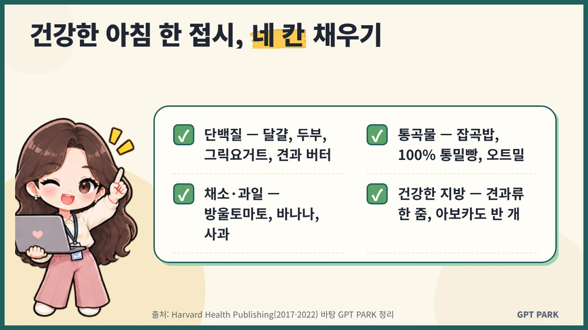
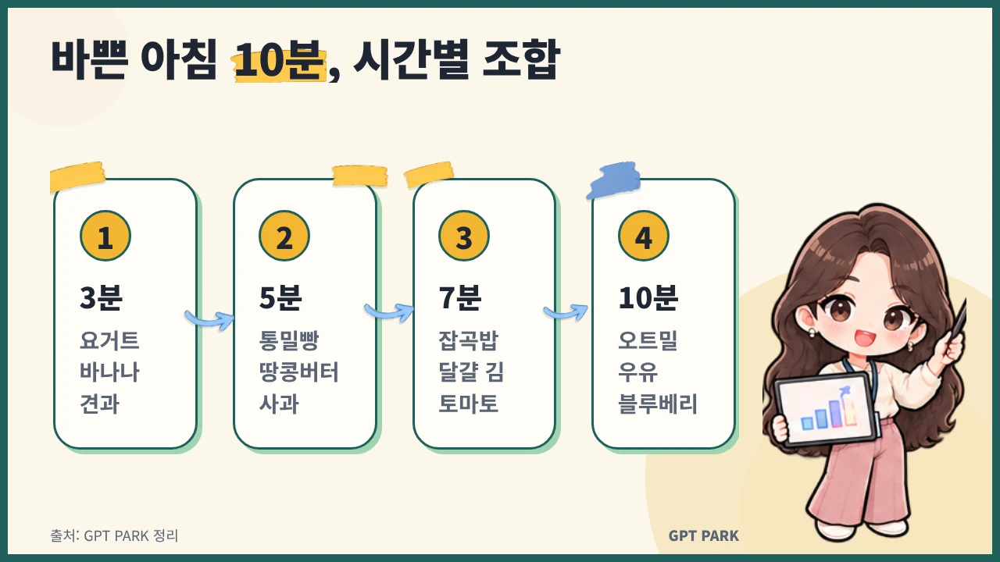

# 기사 패키지: 건강한 사람들의 아침식사

> 작성일: 2026-10-26 · 버전: v1 · 상태: 초안(발행 전 사람 승인 필요)
> `<!-- BEGIN:xxx -->` / `<!-- END:xxx -->` 표식은 `scripts/check_article.py`가 읽는다. 지우지 말 것.

## 1. 키워드
<!-- BEGIN:keywords -->
핵심: 건강한 아침식사
보조: 아침 메뉴 추천, 직장인 아침식사, 아침 결식, 단백질 아침, 통곡물 아침
<!-- END:keywords -->

## 2. 제목안 (★ = 추천)
<!-- BEGIN:titles -->
1. ★ 건강한 아침식사, 바쁜 직장인을 위한 10분 조합 공식
2. 건강한 아침식사 구성법: 단백질·통곡물·과일 하나씩만 기억하세요
3. 건강한 사람들은 아침에 뭘 먹을까? 직장인 아침 메뉴 추천
<!-- END:titles -->
추천 이유: 핵심 키워드를 맨 앞에 두고, 타깃(바쁜 직장인)과 구체적 약속(10분 조합)을 함께 담았어요.

## 3. 메타설명 (구글판, 80~120자)
<!-- BEGIN:meta_description -->
건강한 아침식사는 단백질·통곡물·채소나 과일·건강한 지방을 한 접시에 담는 거예요. 2024년 국민건강영양조사 결식률과 하버드 권고를 바탕으로 직장인이 10분 안에 차리는 조합을 정리했어요.
<!-- END:meta_description -->

## 4. 슬러그
<!-- BEGIN:slug -->
healthy-breakfast-for-busy-workers
<!-- END:slug -->

## 5. 본문 — 구글/워드프레스판
<!-- BEGIN:body_google -->
# 건강한 아침식사, 바쁜 직장인을 위한 10분 조합 공식

건강한 아침식사는 기름기 적은 단백질, 통곡물 탄수화물, 채소나 과일, 건강한 지방을 한 끼에 고루 담는 식사예요. 거창한 요리가 아니라 이 네 가지를 하나씩 골라 조합하면 10분 안에도 충분히 차릴 수 있어요. [근거#8]

**핵심 요약**
- 아침 한 접시 = 단백질 + 통곡물 + 채소·과일 + 건강한 지방, 네 칸을 채우면 돼요.
- 질병관리청 2024년 국민건강영양조사 기준 우리나라 아침 결식률은 35.3%, 30대는 46.8%예요.
- 당이 많은 시리얼·인스턴트 오트밀, 베이컨·소시지는 줄이는 편이 좋아요.

## 건강한 아침식사는 무엇으로 구성하나요?
건강한 아침식사는 단백질, 통곡물, 채소나 과일, 건강한 지방 네 가지로 구성해요. 하버드 의대 건강 출판부(Harvard Health Publishing)는 기름기 적은 단백질과 통곡물 탄수화물, 건강한 지방, 신선한 과일을 함께 먹는 아침을 권해요. [근거#8]



| 칸 | 역할 | 이렇게 고르세요 |
|---|---|---|
| 단백질 | 오전 허기 늦추기 | 달걀, 두부, 그릭요거트, 견과 버터 |
| 통곡물 | 꾸준한 에너지 | 잡곡밥, 100% 통밀빵, 오트밀 |
| 채소·과일 | 식이섬유·비타민 | 방울토마토, 바나나, 사과, 쌈채소 |
| 건강한 지방 | 포만감 | 견과류 한 줌, 아보카도 반 개 |

통곡물 아침을 고를 때는 빵 포장에 "100% whole grain" 또는 "100% whole wheat"라고 적혀 있는지 확인하세요. 하버드 의대 건강 출판부의 2022년 글에 따르면 "멀티그레인", "12곡" 같은 표기만으로는 통곡물이라는 보장이 없어요. [근거#3]

## 한국인은 아침을 얼마나 거르나요?
우리나라 성인 세 명 중 한 명 이상이 아침을 걸러요. 질병관리청 「2024 국민건강영양조사」(2025년 9월 발표) 기준 아침 결식률은 35.3%로, 2015년보다 9.1%포인트 늘었어요. [근거#1]

직장인 나이대만 보면 30대 46.8%, 40대 39.1%, 50대 25.3%예요. 같은 조사에서 19~29세는 62.1%로 가장 높았어요. 아침 결식은 바쁜 출근 시간과 맞물려 30~40대에게 특히 익숙한 습관이라는 뜻이에요. [근거#1]

## 아침을 거르면 몸에 어떤 영향이 있나요?
아침을 습관적으로 거르면 몸에 부담이 될 수 있다는 의견이 있어요. 하버드 의대 건강 출판부는 2017년 글에서 아침을 거르는 습관이 인슐린 저항성, 고혈압, 콜레스테롤 문제의 위험을 높일 수 있다고 소개했어요. [근거#9]

다만 이런 연구는 대부분 관찰 연구라서 아침 한 끼가 질병을 막는다고 단정할 수는 없어요. 제가 권하는 방식은 "꼭 많이 먹기"보다 "가볍더라도 균형 있게 먹기"예요. 당뇨처럼 혈당 관리가 필요한 분은 식사 시간과 구성을 의료진과 상의하세요.

## 바쁜 아침 10분, 어떤 조합이 좋을까요?
바쁜 아침에는 네 칸 중 단백질과 통곡물 두 칸만 먼저 채우고, 과일이나 견과를 곁들이면 충분해요. 직장인 아침식사는 전날 미리 준비해 두면 아침 조리 시간을 크게 줄일 수 있어요.



| 시간 | 아침 메뉴 추천 | 채운 칸 |
|---|---|---|
| 3분 | 그릭요거트 + 바나나 + 견과 한 줌 | 단백질·과일·지방 |
| 5분 | 100% 통밀 토스트 + 땅콩버터 + 사과 슬라이스 | 통곡물·단백질·과일 |
| 7분 | 잡곡밥 반 공기 + 달걀프라이 + 김 + 방울토마토 | 통곡물·단백질·채소 |
| 10분 | 오트밀(전자레인지 2분) + 우유 + 블루베리·호두 | 통곡물·단백질·과일·지방 |

단백질 아침을 챙기기 어렵다면 통곡물 토스트에 견과 버터나 리코타 치즈를 더해 보세요. 하버드 의대 건강 출판부는 이렇게 단백질을 보태면 오전 중 허기를 달래는 데 도움이 된다고 설명해요. [근거#4]

주말에 만들어 두는 달걀 머핀컵도 방법이에요. 같은 글의 예시는 달걀 10개에 다진 채소 약 1컵과 치즈를 섞어 굽는 방식이고, 냉장 4일·냉동 1개월까지 보관할 수 있다고 해요. [근거#10]

[경험 보강 필요: 예) 저자가 실제로 출근 전 챙겨 먹는 조합과 걸리는 시간]

## 건강해 보이지만 피해야 할 아침은 무엇인가요?
건강해 보여도 당이 많거나 가공육 위주인 아침은 줄이는 편이 좋아요. 하버드 의대 건강 출판부(2022년)는 줄일 아침으로 다음을 꼽았어요. [근거#6]

- 한 봉지씩 포장된 인스턴트 오트밀(당이 많은 경우가 많음)
- 그래놀라를 포함한 다수의 시리얼(당이 많은 경우가 많음)
- 베이컨·소시지
- 버터 바른 흰 식빵 토스트

아보카도처럼 몸에 좋은 재료도 양을 봐야 해요. 같은 글에 따르면 아보카도 한 개는 400kcal에 가까워서 반 개 정도가 적당해요. [근거#7]

## 달걀은 매일 먹어도 괜찮나요?
건강한 사람이라면 하루 달걀 한 개 정도는 괜찮을 수 있어요. 하버드 의대 건강 출판부(2022년)는 건강한 사람에게 하루 한 개까지의 달걀은 심장병 위험 증가와 관련이 없을 수 있다고 설명하고, 채소와 함께 먹기를 권해요. [근거#5]

콜레스테롤 수치가 높거나 심혈관 질환이 있다면 섭취량을 의사나 영양사와 상의하세요.

## 자주 묻는 질문
Q. 아침 결식을 하다가 다시 먹기 시작하면 무엇부터 먹을까요?
A. 부담 없는 단백질 한 가지부터 시작하세요. 그릭요거트나 삶은 달걀처럼 준비가 쉬운 음식이 좋아요. 익숙해지면 통곡물과 과일을 하나씩 더해 네 칸을 채우면 돼요.

Q. 한국식 아침(밥·국)도 건강한 아침식사가 될 수 있나요?
A. 네, 구성만 맞추면 충분히 될 수 있어요. 흰쌀밥 대신 잡곡밥, 국은 싱겁게, 반찬에 달걀·두부·생선 같은 단백질과 채소를 넣으면 네 칸이 채워져요.

Q. 커피만 마셔도 아침을 먹은 셈인가요?
A. 커피만으로는 아침식사라고 보기 어려워요. 단백질·통곡물·과일이 빠지기 때문이에요. 커피를 마신다면 요거트나 통밀빵처럼 간단한 음식 하나를 곁들여 보세요.

Q. 그래놀라는 건강한 아침인가요?
A. 제품에 따라 달라서, 고르기 전에 당 함량을 확인하는 게 좋아요. 하버드 의대 건강 출판부는 그래놀라를 포함한 시리얼에 당이 많은 경우가 많다고 지적해요. 무가당 요거트에 소량만 올리는 방식을 권해요.

## 마무리
건강한 아침식사는 단백질, 통곡물, 채소·과일, 건강한 지방 네 칸을 채우는 습관이에요. 내일 아침에는 표에서 시간이 맞는 조합 하나만 골라 시작해 보세요. 이 글은 일반 건강 정보이며, 질환이 있거나 식이 조절 중이라면 의사·영양사와 먼저 상담하세요.

*작성: GPT PARK · 최종 수정: 2026-10-26*
<!-- END:body_google -->

## 6. FAQ
<!-- BEGIN:faq -->
Q. 아침 결식을 하다가 다시 먹기 시작하면 무엇부터 먹을까요?
A. 부담 없는 단백질 한 가지부터 시작하세요. 그릭요거트나 삶은 달걀처럼 준비가 쉬운 음식이 좋아요. 익숙해지면 통곡물과 과일을 하나씩 더해 네 칸을 채우면 돼요.

Q. 한국식 아침(밥·국)도 건강한 아침식사가 될 수 있나요?
A. 네, 구성만 맞추면 충분히 될 수 있어요. 흰쌀밥 대신 잡곡밥, 국은 싱겁게, 반찬에 달걀·두부·생선 같은 단백질과 채소를 넣으면 네 칸이 채워져요.

Q. 커피만 마셔도 아침을 먹은 셈인가요?
A. 커피만으로는 아침식사라고 보기 어려워요. 단백질·통곡물·과일이 빠지기 때문이에요. 커피를 마신다면 요거트나 통밀빵처럼 간단한 음식 하나를 곁들여 보세요.

Q. 그래놀라는 건강한 아침인가요?
A. 제품에 따라 달라서, 고르기 전에 당 함량을 확인하는 게 좋아요. 하버드 의대 건강 출판부는 그래놀라를 포함한 시리얼에 당이 많은 경우가 많다고 지적해요. 무가당 요거트에 소량만 올리는 방식을 권해요.
<!-- END:faq -->

## 7. JSON-LD
<!-- BEGIN:jsonld -->
```json
{
  "@context": "https://schema.org",
  "@graph": [
    {
      "@type": "BlogPosting",
      "headline": "건강한 아침식사, 바쁜 직장인을 위한 10분 조합 공식",
      "description": "건강한 아침식사는 단백질·통곡물·채소나 과일·건강한 지방을 한 접시에 담는 거예요. 2024년 국민건강영양조사 결식률과 하버드 권고를 바탕으로 직장인이 10분 안에 차리는 조합을 정리했어요.",
      "author": {"@type": "Person", "name": "GPT PARK"},
      "datePublished": "2026-10-26",
      "dateModified": "2026-10-26",
      "image": "",
      "mainEntityOfPage": "healthy-breakfast-for-busy-workers"
    },
    {
      "@type": "FAQPage",
      "mainEntity": [
        {"@type": "Question", "name": "아침 결식을 하다가 다시 먹기 시작하면 무엇부터 먹을까요?", "acceptedAnswer": {"@type": "Answer", "text": "부담 없는 단백질 한 가지부터 시작하세요. 그릭요거트나 삶은 달걀처럼 준비가 쉬운 음식이 좋아요. 익숙해지면 통곡물과 과일을 하나씩 더해 네 칸을 채우면 돼요."}},
        {"@type": "Question", "name": "한국식 아침(밥·국)도 건강한 아침식사가 될 수 있나요?", "acceptedAnswer": {"@type": "Answer", "text": "네, 구성만 맞추면 충분히 될 수 있어요. 흰쌀밥 대신 잡곡밥, 국은 싱겁게, 반찬에 달걀·두부·생선 같은 단백질과 채소를 넣으면 네 칸이 채워져요."}},
        {"@type": "Question", "name": "커피만 마셔도 아침을 먹은 셈인가요?", "acceptedAnswer": {"@type": "Answer", "text": "커피만으로는 아침식사라고 보기 어려워요. 단백질·통곡물·과일이 빠지기 때문이에요. 커피를 마신다면 요거트나 통밀빵처럼 간단한 음식 하나를 곁들여 보세요."}},
        {"@type": "Question", "name": "그래놀라는 건강한 아침인가요?", "acceptedAnswer": {"@type": "Answer", "text": "제품에 따라 달라서, 고르기 전에 당 함량을 확인하는 게 좋아요. 하버드 의대 건강 출판부는 그래놀라를 포함한 시리얼에 당이 많은 경우가 많다고 지적해요. 무가당 요거트에 소량만 올리는 방식을 권해요."}}
      ]
    }
  ]
}
```
<!-- END:jsonld -->

## 8. 태그 (워드프레스·티스토리, 5~10개)
<!-- BEGIN:tags -->
#건강한아침식사 #아침메뉴추천 #직장인아침식사 #아침결식 #단백질아침 #통곡물 #간단아침 #건강식단
<!-- END:tags -->

## 9. 링크 제안
- 내부: 직장인 점심 도시락 구성법, 간단한 건강 간식 고르기, 식품 영양성분표 읽는 법
- 외부(1차 출처): 질병관리청 국민건강영양조사 — https://knhanes.kdca.go.kr / Harvard Health Publishing — https://www.health.harvard.edu/nutrition/build-a-better-breakfast

## 10. 이미지 (5단계: 스티커로 꾸민 썸네일·인포그래픽 — `visual-plan.json` → `visuals/`)
<!-- BEGIN:visuals -->
| 위치 | 파일 | 종류 | 사용 스티커 | alt |
|---|---|---|---|---|
| 대표 이미지 (정사각형 1080×1080) | visuals/thumbnail.webp | thumbnail | char-pk-coffee-peace, bubble-white, pk-plant, tape-blue | 건강한 아침식사 10분 조합 공식 — 바쁜 직장인을 위한 단백질·통곡물·채소와 과일·건강한 지방 네 칸 아침 |
| 건강한 아침식사는 무엇으로 구성하나요? 아래 | visuals/four-parts.webp | checklist | char-pk-pointing-laptop | 건강한 아침식사 네 가지 구성 — 단백질, 통곡물, 채소·과일, 건강한 지방 |
| 바쁜 아침 10분, 어떤 조합이 좋을까요? 아래 | visuals/ten-minute-combos.webp | steps | char-pk-chart-tablet, tape, arrow-curve-blue | 직장인 아침 메뉴 추천 시간별 조합 — 3분·5분·7분·10분 |
<!-- END:visuals -->
- 본문 이미지·인포그래픽은 모두 가로형 1280×720. 썸네일만 0단계에서 사람이 고른 비율.

## 11. 참고자료 (발행본 하단 표기용)
1. 질병관리청 「2024 국민건강영양조사 주요 결과」 (뉴시스 보도), 2025-09-30, https://www.newsis.com/view/NISX20250930_0003349661
2. Harvard Health Publishing, "Build a better breakfast", 2022-03-01, https://www.health.harvard.edu/nutrition/build-a-better-breakfast
3. Harvard Health Publishing, "Breakfast and beyond: The case for a healthy morning meal", 2017-05-01, https://www.health.harvard.edu/nutrition/breakfast-and-beyond-the-case-for-a-healthy-morning-meal

## 12. 자체 점검 (AEO 6문항)
1. 첫 단락만으로 답이 되는가: 예 — 네 가지 구성 요소를 첫 문장에서 정의
2. 소제목이 질문형인가: 예 — FAQ·마무리 외 H2 6개 모두 질문형
3. 섹션 첫 문장 단독 의미: 예 — 주어를 밝힌 정의형 답
4. 목록·표: 예 — 구성표, 10분 조합표, 피할 음식 목록
5. 출처·기준일: 예 — 질병관리청 2024 조사(2025년 9월 발표), 하버드 2022·2017년 명시
6. 저자·갱신일: 예 — GPT PARK, 2026-10-26

## 13. 사람이 채워야 할 것 / 확인 필요
- [경험 보강 필요] 저자가 실제로 먹는 아침 조합과 소요 시간
- [확인 필요] 결식률 수치는 뉴시스 보도 기준 — 발행 전 질병관리청 원문(국민건강통계) 확인 권장
- [확인 필요] YMYL(건강) 주제 — 전문가 상담 문장 포함 여부 사람 확인
- 갱신 주기: 국민건강영양조사 새 결과 발표 시(매년)
- 이미지 후보(작성자 메모): "구성하나요?" H2 → checklist(네 칸), "10분 조합" H2 → compare 또는 steps
