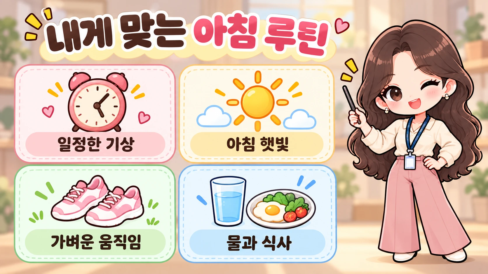
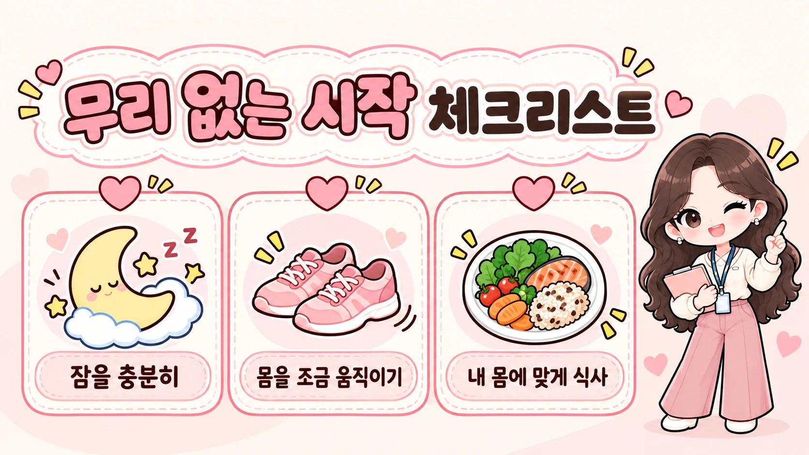

# 기사 패키지: 건강한 사람들의 아침 루틴

> 작성일: 2026-10-26 · 버전: v1 · 상태: 초안(발행 전 사람 확인 필요)

## 1. 키워드
<!-- BEGIN:keywords -->
핵심: 건강한 아침 루틴
보조: 아침 습관, 기상 시간, 아침 햇빛, 아침 운동, 건강한 아침 식사
<!-- END:keywords -->

## 2. 제목안 (★ = 추천)
<!-- BEGIN:titles -->
1. ★ 건강한 아침 루틴, 수면부터 식사까지 무리 없이 시작하는 법
2. 건강한 사람들의 아침 루틴은 무엇이 다를까? 실천 가능한 습관 정리
3. 건강한 아침 루틴 만들기: 기상·햇빛·움직임·식사 체크리스트
<!-- END:titles -->
추천 이유: 특정 기상 시각을 강요하지 않고 독자가 원하는 실행 순서를 보여 줘요.

## 3. 메타설명 (구글판)
<!-- BEGIN:meta_description -->
건강한 아침 루틴은 새벽 기상보다 충분한 수면에서 시작해요. 일정한 기상 시간, 아침 햇빛, 가벼운 움직임, 물과 식사를 내 생활에 맞게 조합하는 방법을 확인하세요.
<!-- END:meta_description -->

## 4. 슬러그
<!-- BEGIN:slug -->
healthy-morning-routine
<!-- END:slug -->

## 5. 본문 — 구글/워드프레스판
<!-- BEGIN:body_google -->
# 건강한 아침 루틴, 수면부터 식사까지 무리 없이 시작하는 법

건강한 아침 루틴은 일찍 일어나는 경쟁이 아니라, 충분히 자고 비슷한 시각에 일어나 몸을 천천히 깨우는 습관이에요. 아침 햇빛, 가벼운 움직임, 물과 식사는 자신의 일정과 건강 상태에 맞게 골라 더하면 됩니다.

**핵심 요약**
- 수면 시간을 줄여 루틴을 만들지 마세요. 먼저 잠과 기상 시간을 살펴보세요.
- 아침에 자연광을 접하고 조금이라도 몸을 움직여 보세요.
- 물과 식사는 정해진 양이나 시각보다 개인 상황에 맞는 선택이 중요해요.

## 건강한 아침 루틴의 시작은 무엇인가요?
건강한 아침 루틴의 출발점은 기상 알람을 앞당기는 일이 아니라 충분한 수면과 규칙적인 수면 일정이에요. 미국 CDC는 18~60세 성인에게 하루 7시간 이상 수면을 권하고, 매일 비슷한 시각에 잠들고 일어나는 습관을 제안해요.[근거#1] 수면이 부족한데 운동과 명상을 위해 더 일찍 일어나면 오히려 필요한 잠을 잃을 수 있어요. [근거#1]

먼저 평일과 휴일의 기상 시간이 크게 흔들리는지 살펴보세요. 시간을 바꾸고 싶다면 잠자리에 드는 시각까지 함께 조정하고, 아침에 개운한지 확인하는 편이 좋아요. 오래 자도 계속 피곤하거나 잠들기 어렵다면 의료진과 상의하세요.[근거#1]

## 아침 햇빛은 왜 도움이 되나요?
아침에 자연광을 접하는 일은 시도하기 쉬운 아침 습관이에요. CDC는 자연광을 하루 중 이른 시간에 충분히 접고, 가능하면 아침이나 점심 무렵 걷기를 제안해요.[근거#2] 창밖을 보는 것부터 시작하고 여건이 되면 잠깐 밖으로 나가 보세요. 여기서 중요한 것은 특정 분량을 억지로 채우는 일이 아니라 생활에 자연광을 더하는 일이에요.



## 아침 운동은 얼마나 해야 하나요?
아침 운동은 처음부터 긴 운동 시간을 확보하지 않아도 시작할 수 있어요. WHO는 활동을 전혀 하지 않는 것보다 조금이라도 움직이는 편이 낫다고 설명해요.[근거#3] 실내에서 몸을 풀거나 짧게 걷는 등 편한 활동을 고르세요. 운동을 아침에만 해야 효과가 있다는 뜻은 아니에요.

참고로 WHO의 성인 신체활동 권고는 주당 중강도 활동 150분 이상 또는 고강도 활동 75분 이상이에요.[근거#3] 이것은 하루 아침에 달성해야 하는 분량이 아니라 한 주의 활동을 살펴보는 기준이에요. 통증이나 어지럼이 있다면 활동을 멈추고 건강 상태에 맞는 조언을 구하세요.

## 일어나자마자 물을 마셔야 하나요?
물을 아침에 마시는 것은 편리한 선택일 수 있지만 모든 사람에게 같은 양이 필요한 것은 아니에요. CDC는 수분 필요량이 나이, 활동량, 임신·수유 상태 등 여러 조건에 따라 달라진다고 설명해요.[근거#4] 목이 마르다면 물을 준비해 마시고, 하루 동안 물을 충분히 마실 기회를 만드는 데 초점을 맞춰 보세요.

단 음료 대신 물을 고르는 것도 실천하기 쉬운 아침 습관이에요. CDC는 물이 당이 든 음료를 대신할 때 열량 섭취를 줄이는 데 도움이 될 수 있다고 설명해요.[근거#4] 수분 섭취를 제한하라는 의료진의 지시가 있다면 그 지시를 우선하세요.

## 건강한 아침 식사는 어떻게 고르나요?
건강한 아침 식사는 정해진 메뉴를 따라 하기보다 여러 식품군을 상황에 맞게 조합하는 방식으로 고를 수 있어요. CDC는 단백질 식품, 채소·과일, 통곡물 등 영양 밀도가 높은 식품을 중심으로 한 식사 패턴을 소개해요.[근거#5] 예를 들어 달걀이나 콩 식품, 과일, 통곡물 빵을 먹을 수 있고, 선호와 예산에 맞게 다른 재료로 바꿔도 돼요.

아침을 먹는 시각과 양도 개인의 일정, 식욕, 건강 상태에 따라 달라질 수 있어요. 당이 많이 들어간 음료나 간식으로만 끼니를 채우기보다 포만감과 영양 구성을 함께 살펴보세요.[근거#5] 당뇨병 치료 등으로 식사 시간 조절이 중요한 사람은 개인 진료 지침을 따르세요.

## 바쁜 날에는 무엇만 지키면 되나요?
바쁜 날의 아침 루틴은 잠을 희생하지 않고 실천 가능한 한두 가지를 남기면 충분해요. 아래 순서는 공식 권고를 일상에 옮긴 예시이며, 의학적으로 정해진 필수 순서가 아니에요.

1. 전날 잠이 부족했다면 아침 일정을 늘리기보다 수면을 우선해요.
2. 일어난 뒤 가능할 때 자연광을 접하고 편한 만큼 움직여요.
3. 갈증과 식욕, 건강 상태에 맞춰 물과 식사를 준비해요.



완벽한 계획보다 이어갈 수 있는 아침 습관이 중요해요. [경험 보강 필요: 실제로 시도한 루틴과 조정한 이유를 저자가 확인해 추가]

## 자주 묻는 질문
**Q. 건강하려면 꼭 새벽에 일어나야 하나요?**  
아니요. 충분한 수면을 확보하고 일정한 수면 일정을 유지하는 것이 우선이에요.[근거#1]

**Q. 아침 운동을 못 하면 저녁에 해도 되나요?**  
네. WHO의 권고는 아침 시간대를 필수로 정하지 않고 한 주 전체의 신체활동을 다뤄요.[근거#3]

**Q. 일어나자마자 물 한 컵을 꼭 마셔야 하나요?**  
정해진 한 컵을 모두에게 요구할 근거는 없어요. 수분 필요량은 개인 상황에 따라 달라지므로 갈증과 건강 상태를 고려하세요.[근거#4]

## 마무리
내일 아침에는 기상 시각과 수면 상태를 먼저 살펴보세요. 자연광, 가벼운 활동, 물과 식사 중 자신의 생활에 맞는 한 가지를 더해 가면 됩니다. 계속 피곤하거나 수면·활동·식사와 관련된 건강 문제가 있다면 의료진과 상담하세요.

*작성: [저자명 확인 필요] · 최종 수정: 2026-10-26*
<!-- END:body_google -->

## 6. FAQ
<!-- BEGIN:faq -->
Q. 건강하려면 꼭 새벽에 일어나야 하나요?
A. 아니요. 충분한 수면을 확보하고 일정한 수면 일정을 유지하는 것이 우선이에요.

Q. 아침 운동을 못 하면 저녁에 해도 되나요?
A. 네. WHO의 권고는 아침 시간대를 필수로 정하지 않고 한 주 전체의 신체활동을 다뤄요.

Q. 일어나자마자 물 한 컵을 꼭 마셔야 하나요?
A. 정해진 한 컵을 모두에게 요구할 근거는 없어요. 수분 필요량은 개인 상황에 따라 달라지므로 갈증과 건강 상태를 고려하세요.
<!-- END:faq -->

## 7. JSON-LD
<!-- BEGIN:jsonld -->
```json
{
  "@context": "https://schema.org",
  "@type": "BlogPosting",
  "headline": "건강한 아침 루틴, 수면부터 식사까지 무리 없이 시작하는 법",
  "description": "건강한 아침 루틴은 새벽 기상보다 충분한 수면에서 시작해요. 일정한 기상 시간, 아침 햇빛, 가벼운 움직임, 물과 식사를 내 생활에 맞게 조합하는 방법을 확인하세요.",
  "author": {"@type": "Person", "name": "[저자명 확인 필요]"},
  "datePublished": "2026-10-26",
  "dateModified": "2026-10-26",
  "image": "",
  "mainEntityOfPage": ""
}
```
<!-- END:jsonld -->

## 8. 태그
<!-- BEGIN:tags -->
#아침루틴 #건강한아침 #생활습관 #수면습관 #아침운동 #아침식사 #수분섭취 #건강관리
<!-- END:tags -->

## 9. 링크 제안
- 내부: 수면 위생 실천법, 걷기 습관 시작하기(해당 글이 실제 있을 때만 연결)
- 외부: CDC 수면, CDC 자연광·수면, WHO 신체활동, CDC 수분, CDC 건강한 식사

## 10. 이미지
<!-- BEGIN:visuals -->
| 위치 | 파일 | 종류 | 사용 스티커 | alt |
|---|---|---|---|---|
| 대표 이미지 (가로형 16:9) | visuals/thumbnail.webp | thumbnail | 사용자 제공 시트 참고 캐릭터 | 건강한 아침 루틴의 수면, 햇빛, 움직임, 식사 주제 |
| 아침 햇빛은 왜 도움이 되나요? 아래 | visuals/morning-flow.webp | steps | 사용자 제공 시트 참고 캐릭터 | 일정한 기상, 아침 햇빛, 가벼운 움직임, 물과 식사로 구성한 아침 루틴 |
| 바쁜 날에는 무엇만 지키면 되나요? 아래 | visuals/simple-checklist.webp | checklist | 사용자 제공 시트 참고 캐릭터 | 잠을 충분히, 몸을 조금 움직이기, 내 몸에 맞게 식사라는 무리 없는 아침 체크리스트 |
<!-- END:visuals -->

## 11. 참고자료
1. CDC, About Sleep, 2024-05-15, https://www.cdc.gov/sleep/about/
2. CDC, About Sleep and Your Heart Health, 2024-05-15, https://www.cdc.gov/heart-disease/about/sleep-and-heart-health.html
3. WHO, Physical activity, 열람 2026-10-26, https://www.who.int/initiatives/behealthy/physical-activity/
4. CDC, About Water and Healthier Drinks, 2026-03-05, https://www.cdc.gov/healthy-weight-growth/water-healthy-drinks/
5. CDC, Healthy Eating Tips, 2026-03-02, https://www.cdc.gov/nutrition/features/healthy-eating-tips.html

## 12. 자체 점검 (AEO 6문항)
1. 첫 단락만으로 답이 되는가: 예 — 수면, 기상, 햇빛, 움직임, 식사를 직접 요약.
2. 소제목이 질문형인가: 예 — 본문 H2 모두 질문형.
3. 첫 문장을 따로 읽어도 뜻이 통하는가: 예 — 각 H2 첫 문장에 주어와 결론 제시.
4. 숫자·절차가 명확한가: 예 — 수면 및 주간 활동 권고의 대상 명시, 최소 루틴 번호 목록.
5. 주장마다 출처가 있는가: 예 — CDC·WHO 원문 연결.
6. 누가 쓰고 언제 갱신했는가: 날짜 기입, 저자는 게시 전 확인 필요.

## 13. 사람이 채워야 할 것 / 확인 필요
- [경험 보강 필요] 실제 시도한 루틴과 조정 이유가 있다면 저자가 확인해 추가.
- [확인 필요] 저자명, 게시 URL, 대표 이미지 공개 URL을 게시 전 입력.
- 갱신 주기: 6개월 또는 공공기관 권고 변경 시.
- 이미지 후보: 아침 루틴 구성(steps), 바쁜 날 최소 루틴(checklist).
