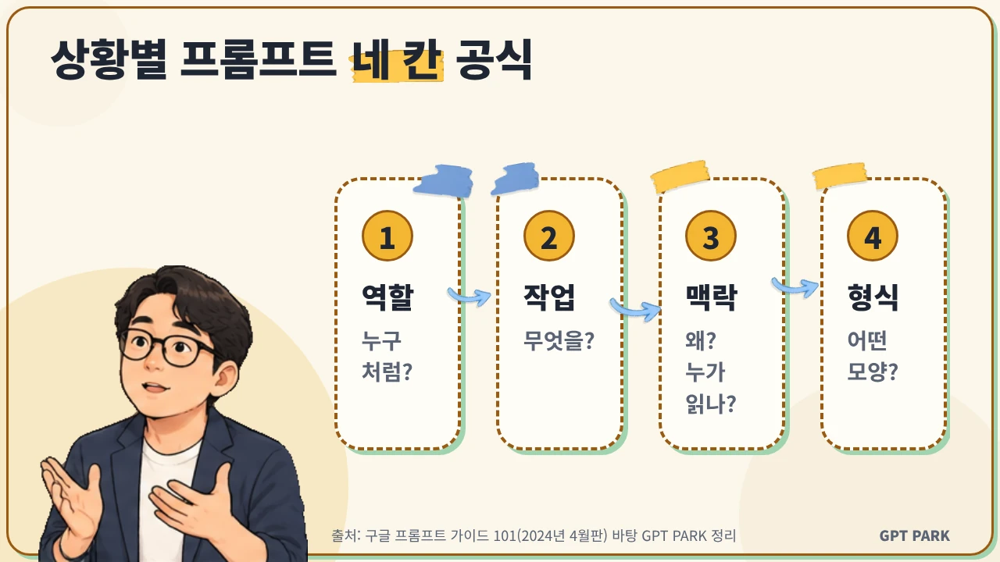
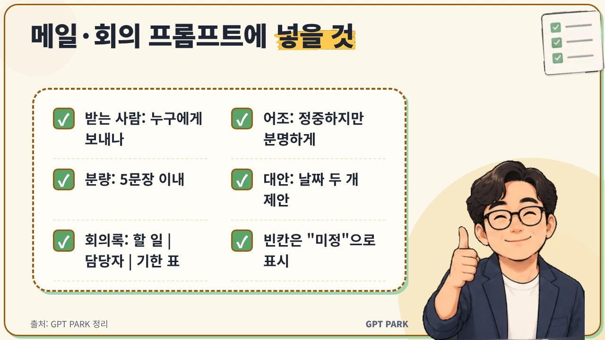

# 기사 패키지: 팀장이 알려주는 상황별 프롬프트 10개

> 작성일: 2026-10-26 · 버전: v1 · 상태: 초안(발행 전 사람 승인 필요)
> `<!-- BEGIN:xxx -->` / `<!-- END:xxx -->` 표식은 `scripts/check_article.py`가 읽는다. 지우지 말 것.

## 1. 키워드
<!-- BEGIN:keywords -->
핵심: 상황별 프롬프트
보조: 업무 프롬프트 예시, 직장인 AI 활용, 보고서 프롬프트, 회의록 프롬프트, 메일 프롬프트, 프롬프트 작성법
<!-- END:keywords -->

## 2. 제목안 (★ = 추천)
<!-- BEGIN:titles -->
1. ★ 상황별 프롬프트 10개, 팀장이 신입에게 알려주는 업무 템플릿
2. 팀장이 알려주는 상황별 프롬프트 10개, 보고서부터 인수인계까지
3. 상황별 프롬프트 10개로 끝내는 직장인 AI 활용 첫걸음
<!-- END:titles -->
추천 이유: 핵심 키워드를 맨 앞에 두고, "팀장→신입" 각도와 "복사해 쓰는 템플릿"이라는 혜택을 함께 보여 줌.

## 3. 메타설명 (구글판, 80~120자)
<!-- BEGIN:meta_description -->
팀장이 신입에게 알려주는 상황별 프롬프트 10개를 정리했어요. 지시 확인, 보고서 요약, 메일, 회의록, 엑셀, 인수인계까지 복사해서 바로 쓰는 업무 템플릿과 다듬는 법을 담았습니다.
<!-- END:meta_description -->

## 4. 슬러그
<!-- BEGIN:slug -->
team-leader-situational-prompts
<!-- END:slug -->

## 5. 본문 — 구글/워드프레스판
<!-- BEGIN:body_google -->
# 상황별 프롬프트 10개, 팀장이 신입에게 알려주는 업무 템플릿

상황별 프롬프트는 "지금 어떤 일을 하는지"에 맞춰 AI에게 역할·작업·맥락·형식을 미리 정해 주는 문장 틀이에요. 이 글에는 팀장이 신입 팀원에게 일을 맡기듯 쓴 업무 프롬프트 10개를 상황별로 묶었습니다. 대괄호 부분만 바꿔서 그대로 복사해 쓰면 돼요.

**핵심 요약**
- 상황별 프롬프트는 역할·작업·맥락·형식 네 칸을 채우는 틀이에요.
- 업무 파악, 보고, 메일·회의, 엑셀·응대·인수인계 네 묶음에 10개를 담았어요.
- 첫 답은 초안으로 보고, 후속 질문으로 다듬은 뒤 사실은 직접 확인해요.

## 팀장은 왜 프롬프트를 상황별로 알려주나요?

팀장이 프롬프트를 상황별로 알려주는 이유는 AI가 일의 배경을 모르는 신입 직원과 비슷하기 때문이에요. Anthropic은 Claude 공식 문서에서 Claude를 "뛰어나지만 팀의 규칙과 업무 방식을 모르는 신입 직원"처럼 생각하고, 원하는 것을 정확히 설명할수록 결과가 좋아진다고 안내해요. [근거#5]

그래서 저는 "AI한테 물어봐"보다 "이 상황에선 이 틀로 시켜 봐"가 더 쓸모 있는 조언이라고 생각해요. 구글의 「Gemini for Google Workspace 프롬프트 가이드 101」(2024년 4월판)은 Workspace Labs 프로그램에서 가장 성공적이었던 프롬프트가 평균 약 21단어였고, 사람들이 흔히 시도하는 프롬프트는 대개 9단어 미만이었다고 밝혀요(영문 가이드 기준). [근거#2]

[경험 보강 필요: 예) 팀원에게 프롬프트 틀을 알려준 뒤 보고서 초안이 어떻게 달라졌는지 한두 문장]

## 상황별 프롬프트는 어떤 틀로 쓰나요?

상황별 프롬프트는 역할(누구처럼), 작업(무엇을), 맥락(왜·누구에게), 형식(어떤 모양으로) 네 칸으로 쓰면 돼요. 구글 프롬프트 가이드도 효과적인 프롬프트의 네 영역으로 페르소나·작업·맥락·형식을 꼽고, 네 개를 모두 쓸 필요는 없다고 설명해요. [근거#1]

| 칸 | 묻는 것 | 예시 |
|---|---|---|
| 역할 | 누구처럼 답할까? | 10년 차 기획팀 선배 |
| 작업 | 무엇을 할까? | 보고서를 한 장으로 요약 |
| 맥락 | 왜, 누가 읽나? | 내일 팀장 보고용, 바쁜 임원이 읽음 |
| 형식 | 어떤 모양으로? | 결론 먼저, 표 하나, 5줄 이내 |

이 표가 곧 프롬프트 작성법의 뼈대예요. 아래 10개 템플릿도 모두 이 네 칸을 채운 모양입니다.



## 업무 파악·지시 확인 상황에서는 어떤 프롬프트를 쓰나요?

처음 맡은 일이나 애매한 지시 앞에서는 AI에게 답을 바로 받기보다 "무엇을 모르는지"부터 정리하게 하는 프롬프트가 좋아요. 일을 시작하기 전 질문 목록을 만들어 두면 다시 하는 일을 줄일 수 있어요.

**① 처음 맡은 업무를 파악할 때**
> 너는 [부서] 10년 차 선배야. 내가 [업무명]을 처음 맡았어. 이 업무에서 꼭 알아야 할 용어 5개와 흔히 하는 실수 3가지를 신입 눈높이로 설명해 줘. 표로 정리해 줘.

**② 지시가 애매할 때**
> 팀장에게 이런 지시를 받았어: "[지시 내용]". 이 일을 시작하기 전에 팀장에게 확인해야 할 질문 5개를 우선순위대로 뽑아 줘. 질문마다 왜 필요한지 한 줄씩 붙여 줘.

## 보고서·보고 준비 상황에서는 어떤 프롬프트를 쓰나요?

보고서 프롬프트의 핵심은 "누가 읽는지"와 "결론을 어디에 둘지"를 정해 주는 거예요. 읽는 사람이 정해지면 AI가 분량과 용어 수준을 맞추기 쉬워져요.

**③ 보고서를 한 장으로 줄일 때**
> 아래 보고서를 바쁜 임원이 1분 안에 읽을 수 있게 한 장으로 요약해 줘. 맨 위에 결론 한 문장, 그 아래 근거 3줄, 마지막에 필요한 결정 사항을 써 줘. 숫자는 원문 그대로 써 줘.
> [보고서 붙여 넣기]

**④ 보고 전에 예상 질문을 대비할 때**
> 너는 꼼꼼한 [직급]이야. 아래 보고 내용을 듣고 나올 만한 날카로운 질문 5개와, 각 질문에 내가 준비할 자료를 알려 줘.
> [보고 내용]

## 메일·회의 상황에서는 어떤 프롬프트를 쓰나요?

메일 프롬프트와 회의록 프롬프트는 받는 사람, 어조, 다음 행동을 함께 적어 주면 결과가 안정돼요. OpenAI 도움말 센터도 원하는 어조를 "격식 있는", "친근한" 같은 형용사로 알려 주라고 권해요. [근거#4]

**⑤ 일정을 조율하거나 거절할 때**
> [상대: 협력사 담당자]에게 보낼 메일을 써 줘. 요청받은 [일정/업무]를 이번 주에는 어렵다고 정중하게 알리고, 대안 날짜 두 개를 제안해 줘. 어조는 정중하지만 분명하게, 5문장 이내로.

**⑥ 회의를 준비할 때**
> [회의 주제]로 30분 회의를 해. 참석자는 [참석자]야. 안건 3개와 안건별 시간 배분, 미리 공유할 자료 목록을 만들어 줘.

**⑦ 회의록을 할 일로 바꿀 때**
> 아래 회의 메모에서 결정 사항과 할 일을 뽑아 줘. 할 일은 "할 일 | 담당자 | 기한" 표로 만들고, 담당자나 기한이 없으면 "미정"으로 표시해 줘.
> [회의 메모]



## 엑셀·대외 응대·인수인계 상황에서는 어떤 프롬프트를 쓰나요?

엑셀, 고객 응대, 인수인계처럼 실수 비용이 큰 일은 조건과 순서를 번호로 나눠 주는 프롬프트가 좋아요. Anthropic 문서도 순서나 빠짐없는 진행이 중요하면 지시를 번호 목록 단계로 주라고 안내해요. [근거#5]

**⑧ 엑셀 수식이 막힐 때**
> 엑셀에서 A열은 날짜, B열은 거래처, C열은 금액이야. 거래처별 월 합계를 구하는 수식을 알려 줘. 수식을 어느 셀에 넣는지, 각 부분이 무슨 뜻인지 단계별로 설명해 줘.

**⑨ 고객·협력사 불만에 답할 때**
> 아래 불만 메일에 보낼 답장 초안을 써 줘. 1) 불편에 대한 사과 2) 확인된 사실 3) 다음 조치와 일정 순서로 쓰고, 확인되지 않은 내용은 약속하지 마. 어조는 정중하고 차분하게.
> [불만 메일]

**⑩ 인수인계 문서를 만들 때**
> 내가 맡던 [업무]를 후임에게 넘겨. 아래 메모를 바탕으로 인수인계 문서를 만들어 줘. 업무 개요, 주기별 할 일, 주요 연락처 역할, 자주 생기는 문제와 대처법, 진행 중인 건 순서로 정리해 줘.
> [메모]

## AI 답이 마음에 안 들면 어떻게 다시 시키나요?

AI 답이 마음에 안 들면 처음부터 다시 쓰기보다 무엇이 아쉬운지 짚어 후속 프롬프트로 고치면 돼요. 구글 가이드와 OpenAI 도움말 센터 모두 응답을 보고 다듬는 반복 과정을 권해요. [근거#3] [근거#4]

- "더 짧게, 세 줄로 줄여 줘"
- "숫자는 그대로 두고 문장만 쉽게 바꿔 줘"
- "이 답에서 틀렸을 수 있는 부분을 표시해 줘"

Anthropic 문서는 맥락이 적은 동료에게 프롬프트를 보여 줬을 때 헷갈려하면 Claude도 헷갈린다는 점검법을 소개해요. [근거#5] 결과가 엉뚱하면 프롬프트를 옆자리 동료가 읽는다고 생각하고 빠진 맥락을 채워 보세요.

## 회사 업무에 프롬프트를 쓸 때 무엇을 조심해야 하나요?

회사 업무에 프롬프트를 쓸 때는 넣는 자료와 나온 답, 두 가지를 조심해야 해요. 제가 권하는 원칙은 아래 세 가지예요.

1. **회사 보안 규정을 먼저 확인해요.** 고객 이름·연락처, 계약 금액, 미공개 자료는 회사가 허용한 AI 도구와 방식으로만 다뤄요.
2. **숫자와 사실은 원문과 대조해요.** AI 요약은 초안이에요. 보고서에 들어갈 숫자는 직접 확인해요.
3. **최종 책임은 사람이 져요.** 메일 발송, 보고 제출 전에는 내 이름으로 내보내도 되는 글인지 한 번 더 읽어요.

이 세 가지를 지키는 것이 직장인 AI 활용의 기본기라고 생각해요.

## 자주 묻는 질문

**Q. 프롬프트는 길게 쓸수록 좋은가요?**
A. 무조건 길 필요는 없고, 필요한 맥락이 빠지지 않는 것이 중요해요. 구글 가이드는 간결하되 구체적으로 쓰라고 권해요. 역할·작업·맥락·형식 중 비어 있는 칸이 없는지부터 확인해 보세요.

**Q. 같은 프롬프트를 매번 다시 입력해야 하나요?**
A. 자주 쓰는 틀은 메모장이나 사내 문서에 저장해 두고 대괄호 부분만 바꿔 쓰면 편해요. 팀 단위로 템플릿을 모아 두면 신입도 같은 수준의 결과를 내기 쉬워져요.

**Q. 챗GPT와 제미나이, 클로드 중 어디에 써야 하나요?**
A. 이 글의 템플릿은 특정 도구 전용이 아니라 대화형 AI라면 어디에나 쓸 수 있어요. 회사가 허용한 도구가 있다면 그 도구를 우선 쓰세요.

**Q. 신입에게 프롬프트를 알려줄 때 무엇부터 가르치면 좋을까요?**
A. 제가 권하는 순서는 네 칸 틀을 먼저 알려 주고, 지시 확인(②)과 회의록 정리(⑦)처럼 매일 쓰는 상황부터 연습하게 하는 거예요. 익숙해지면 나머지 상황으로 넓히면 돼요.

## 마무리

상황별 프롬프트는 역할·작업·맥락·형식 네 칸을 채운 문장 틀이고, 이 글의 업무 프롬프트 예시 10개는 모두 그 틀로 만들었어요. 오늘은 가장 자주 하는 일 하나를 골라 템플릿을 한 번 써 보고, 결과를 후속 질문으로 다듬어 보세요. 프롬프트를 더 잘 쓰는 원리가 궁금하다면 「프롬프트 잘 쓰는 법, 저는 질문보다 규칙을 먼저 씁니다」도 함께 읽어 보세요.

*작성: GPT PARK · 최종 수정: 2026-10-26*
<!-- END:body_google -->

## 6. FAQ
<!-- BEGIN:faq -->
Q. 프롬프트는 길게 쓸수록 좋은가요?
A. 무조건 길 필요는 없고, 필요한 맥락이 빠지지 않는 것이 중요해요. 구글 가이드는 간결하되 구체적으로 쓰라고 권해요. 역할·작업·맥락·형식 중 비어 있는 칸이 없는지부터 확인해 보세요.

Q. 같은 프롬프트를 매번 다시 입력해야 하나요?
A. 자주 쓰는 틀은 메모장이나 사내 문서에 저장해 두고 대괄호 부분만 바꿔 쓰면 편해요. 팀 단위로 템플릿을 모아 두면 신입도 같은 수준의 결과를 내기 쉬워져요.

Q. 챗GPT와 제미나이, 클로드 중 어디에 써야 하나요?
A. 이 글의 템플릿은 특정 도구 전용이 아니라 대화형 AI라면 어디에나 쓸 수 있어요. 회사가 허용한 도구가 있다면 그 도구를 우선 쓰세요.

Q. 신입에게 프롬프트를 알려줄 때 무엇부터 가르치면 좋을까요?
A. 제가 권하는 순서는 네 칸 틀을 먼저 알려 주고, 지시 확인(②)과 회의록 정리(⑦)처럼 매일 쓰는 상황부터 연습하게 하는 거예요. 익숙해지면 나머지 상황으로 넓히면 돼요.
<!-- END:faq -->

## 7. JSON-LD
<!-- BEGIN:jsonld -->
```json
{
  "@context": "https://schema.org",
  "@graph": [
    {
      "@type": "BlogPosting",
      "headline": "상황별 프롬프트 10개, 팀장이 신입에게 알려주는 업무 템플릿",
      "description": "팀장이 신입에게 알려주는 상황별 프롬프트 10개를 정리했어요. 지시 확인, 보고서 요약, 메일, 회의록, 엑셀, 인수인계까지 복사해서 바로 쓰는 업무 템플릿과 다듬는 법을 담았습니다.",
      "author": {"@type": "Person", "name": "GPT PARK"},
      "datePublished": "2026-10-26",
      "dateModified": "2026-10-26",
      "image": "https://cdn.jsdelivr.net/gh/muzbox1973/my_blog_muz@4fad9ca2bb672968fbd16bde730b7d86922544b9/blog-harness-fast/posts/20261026-team-leader-situational-prompts/visuals/thumbnail.webp",
      "mainEntityOfPage": ""
    },
    {
      "@type": "FAQPage",
      "mainEntity": [
        {"@type": "Question", "name": "프롬프트는 길게 쓸수록 좋은가요?", "acceptedAnswer": {"@type": "Answer", "text": "무조건 길 필요는 없고, 필요한 맥락이 빠지지 않는 것이 중요해요. 구글 가이드는 간결하되 구체적으로 쓰라고 권해요. 역할·작업·맥락·형식 중 비어 있는 칸이 없는지부터 확인해 보세요."}},
        {"@type": "Question", "name": "같은 프롬프트를 매번 다시 입력해야 하나요?", "acceptedAnswer": {"@type": "Answer", "text": "자주 쓰는 틀은 메모장이나 사내 문서에 저장해 두고 대괄호 부분만 바꿔 쓰면 편해요. 팀 단위로 템플릿을 모아 두면 신입도 같은 수준의 결과를 내기 쉬워져요."}},
        {"@type": "Question", "name": "챗GPT와 제미나이, 클로드 중 어디에 써야 하나요?", "acceptedAnswer": {"@type": "Answer", "text": "이 글의 템플릿은 특정 도구 전용이 아니라 대화형 AI라면 어디에나 쓸 수 있어요. 회사가 허용한 도구가 있다면 그 도구를 우선 쓰세요."}},
        {"@type": "Question", "name": "신입에게 프롬프트를 알려줄 때 무엇부터 가르치면 좋을까요?", "acceptedAnswer": {"@type": "Answer", "text": "제가 권하는 순서는 네 칸 틀을 먼저 알려 주고, 지시 확인(②)과 회의록 정리(⑦)처럼 매일 쓰는 상황부터 연습하게 하는 거예요. 익숙해지면 나머지 상황으로 넓히면 돼요."}}
      ]
    }
  ]
}
```
<!-- END:jsonld -->

## 8. 태그 (워드프레스·티스토리, 5~10개)
<!-- BEGIN:tags -->
#상황별프롬프트 #업무프롬프트예시 #직장인AI활용 #보고서프롬프트 #회의록프롬프트 #메일프롬프트 #프롬프트작성법 #신입업무팁 #GPTPARK
<!-- END:tags -->

## 9. 링크 제안
- 내부: 업무 프롬프트 5선, 메일·회의록·보고서까지 복사해서 쓰세요 / 프롬프트 잘 쓰는 법, 저는 질문보다 규칙을 먼저 씁니다
- 외부(1차 출처): Google Gemini for Google Workspace Prompting Guide 101 / OpenAI 도움말 센터 / Anthropic Claude Docs

## 10. 이미지 (5단계: 스티커로 꾸민 썸네일·인포그래픽 — `visual-plan.json` → `visuals/`)
<!-- BEGIN:visuals -->
| 위치 | 파일 | 종류 | 사용 스티커 | alt |
|---|---|---|---|---|
| 대표 이미지 (정사각형 1080×1080) | visuals/thumbnail.webp | thumbnail | char-pointing-idea, bubble-yellow, notebook-pen, coffee-mug | 팀장이 알려주는 상황별 프롬프트 10개 — 보고서부터 인수인계까지 복사해서 쓰는 업무 템플릿 |
| 상황별 프롬프트는 어떤 틀로 쓰나요? 아래 | visuals/steps-1.webp | steps | char-explain | 상황별 프롬프트 네 칸 공식 — 역할(누구처럼), 작업(무엇을), 맥락(왜·누가 읽나), 형식(어떤 모양으로) |
| 메일·회의 상황에서는 어떤 프롬프트를 쓰나요? 아래 | visuals/check-1.webp | checklist | char-thumbsup, checklist | 메일·회의 프롬프트에 넣을 것 체크리스트 — 받는 사람, 어조, 분량, 대안, 할 일·담당자·기한 표, 빈칸은 미정 표시 |
<!-- END:visuals -->

## 11. 참고자료 (발행본 하단 표기용)
1. Google, Gemini for Google Workspace: Prompting Guide 101, 2024년 4월판, https://services.google.com/fh/files/misc/gemini-for-google-workspace-prompting-guide-101.pdf
2. OpenAI 도움말 센터, Prompt engineering best practices for ChatGPT, 2026년 10월 열람, https://help.openai.com/en/articles/10032626-prompt-engineering-best-practices-for-chatgpt
3. Anthropic, Claude Docs — Be clear and direct, 2026년 10월 열람, https://platform.claude.com/docs/en/build-with-claude/prompt-engineering/be-clear-and-direct

## 12. 자체 점검 (AEO 6문항)
1. 첫 단락만으로 답이 되는가: 예 — 정의(네 칸 틀)와 이 글의 내용(10개, 복사해 쓰기)을 첫 단락에 제시
2. 소제목이 질문형인가: 예 — FAQ·마무리 제외 H2 8개 모두 질문형
3. 섹션 첫 문장이 단독으로 통하는가: 예 — 각 H2 첫 문장에 주어 명시
4. 숫자·정의·절차가 목록·표인가: 예 — 네 칸 표, 템플릿 번호, 주의 번호 목록
5. 주장마다 출처·기준일: 예 — 구글(2024년 4월판), OpenAI·Anthropic 문서명 명시 / 의견 문장은 "제가 권하는" 표지
6. 저자·갱신일: 예 — 하단 작성자·최종 수정일

## 13. 사람이 채워야 할 것 / 확인 필요
- [경험 보강 필요] "팀장은 왜…" 섹션: 팀원에게 프롬프트 틀을 알려준 실제 사례 1~2문장
- [확인 필요] 제목·본문이 "팀장" 시점이에요. 저자가 실제로 팀원을 지도하는 입장이 아니라면 제목을 "선배가 알려주는" 등으로 바꾸세요.
- 갱신 주기: 6개월마다(각 AI 공식 가이드 개정 시)
- 이미지 후보(작성자 메모): "어떤 틀로 쓰나요?" → steps(네 칸) / "메일·회의" → checklist
