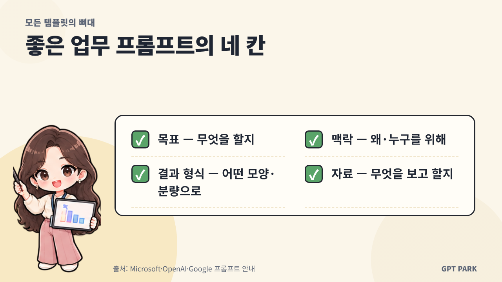
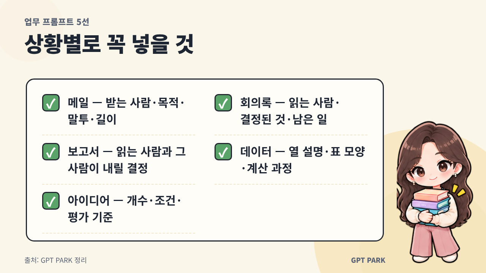
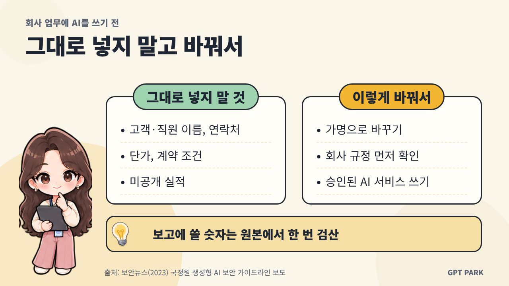

# 기사 패키지: 업무 상황별 프롬프트 5선

> 작성일: 2026-10-26 · 버전: v2.1(이미지 반영) · 상태: 초안(발행 전 사람 승인 필요)
> `<!-- BEGIN:xxx -->` / `<!-- END:xxx -->` 표식은 `scripts/check_article.py`가 읽는다. 지우지 말 것.

## 1. 키워드
<!-- BEGIN:keywords -->
핵심: 업무 프롬프트
보조: 직장인 프롬프트 예시, 업무용 AI 프롬프트, 이메일 작성 프롬프트, 회의록 요약 프롬프트, 보고서 작성 프롬프트, 엑셀 데이터 분석 프롬프트, ChatGPT 업무 활용
<!-- END:keywords -->

## 2. 제목안 (★ = 추천)
<!-- BEGIN:titles -->
1. ★ 업무 프롬프트 5선, 메일·회의록·보고서까지 복사해서 쓰세요
2. 직장인 업무 프롬프트 예시 5가지, 상황별 템플릿 정리
3. 업무용 AI 프롬프트 5개로 메일부터 엑셀까지 해결하기
<!-- END:titles -->
추천 이유: 핵심 키워드를 맨 앞에 두고, 독자가 얻는 것(복사해서 바로 쓰는 템플릿)과 대표 상황 세 가지를 제목에 담았다.

## 3. 메타설명 (구글판, 80~120자)
<!-- BEGIN:meta_description -->
업무 프롬프트를 메일·회의록·보고서·엑셀·아이디어 다섯 상황으로 정리했어요. 목표·맥락·결과 형식만 바꿔 복사해 쓰는 템플릿과 결과를 고치는 후속 질문, 보안 주의점까지 담았어요.
<!-- END:meta_description -->

## 4. 슬러그
<!-- BEGIN:slug -->
work-prompt-templates-5-situations
<!-- END:slug -->

## 5. 본문 — 구글/워드프레스판
<!-- BEGIN:body_google -->
# 업무 프롬프트 5선, 메일·회의록·보고서까지 복사해서 쓰세요

업무 프롬프트는 메일, 회의록, 보고서, 엑셀 데이터, 아이디어 회의 다섯 상황의 템플릿만 갖춰 두면 자주 하는 사무 업무에 바로 쓸 수 있어요. 다섯 템플릿은 모두 목표·맥락·결과 형식·자료 네 칸으로 만들었기 때문에, 대괄호 칸만 내 상황으로 바꿔 쓰면 됩니다.

**핵심 요약**
- 좋은 업무용 AI 프롬프트는 목표·맥락·결과 형식·자료 네 칸으로 나눠 써요.
- 메일·회의록·보고서·데이터·아이디어 다섯 상황별 템플릿을 복사해 대괄호만 바꾸세요.
- 결과가 어긋나면 처음부터 다시 쓰기보다 후속 질문 한 줄로 고쳐 보세요.

## 업무 프롬프트는 어떻게 써야 결과가 좋아지나요?
업무 프롬프트는 무엇을 할지(목표), 왜·누구를 위해 하는지(맥락), 어떤 모양으로 받을지(결과 형식), 무엇을 보고 할지(자료)를 나눠 쓰면 원하는 결과에 가까워져요. 마이크로소프트는 코파일럿 안내에서 좋은 프롬프트를 목표·맥락·자료·기대 네 부분으로 설명하며, 목표만 있어도 되지만 원하는 결과를 얻으려면 다른 부분도 더하는 것이 좋다고 밝혔어요. [근거#1] 구글도 업무용 제미나이 가이드(2024년 4월판)에서 페르소나·작업·맥락·형식 네 영역을 제시합니다. [근거#3]

오픈AI 가이드가 권하는 두 가지 습관도 템플릿에 넣었어요. 지시를 맨 앞에 두고 지시와 자료 사이를 ### 기호로 나누는 것, 그리고 "짧게" 대신 "3~5문장"처럼 잴 수 있는 말로 쓰는 것입니다. [근거#2] 템플릿에 가끔 보이는 [규칙] 줄은 "지어내지 말 것"처럼 꼭 지킬 조건이 있을 때만 붙이는 선택 줄이에요.



## 업무 메일을 쓸 때는 어떤 프롬프트가 좋나요?
이메일 작성 프롬프트에는 받는 사람, 메일의 목적, 말투, 길이를 꼭 넣어야 해요. 이 네 가지가 빠지면 AI가 누구에게나 보낼 수 있는 무난한 인사말 위주로 길게 쓰기 쉬워요.

> [목표] 거래처 담당자에게 납기 일정 변경을 알리는 메일을 써 줘.
> [맥락] 받는 사람: ○○사 구매 담당 과장 / 변경 이유: (한 줄로) / 바뀐 일정: ○월 ○일 → ○월 ○일
> [결과 형식] 제목 1줄 + 본문 5~7문장. 정중하되 변명처럼 들리지 않게 쓰고, 마지막 문장에 대안을 1가지 제안해 줘.
> ###
> [자료] 이전에 주고받은 메일이 있으면 여기에 붙여 넣기

## 회의록은 어떻게 정리를 맡기나요?
회의록 요약 프롬프트는 누가 읽을 회의록인지 알려 주고, 결정된 것과 남은 일을 나눠 뽑아 달라고 요청하는 것이 핵심이에요. 마이크로소프트 코파일럿 프롬프트 갤러리에 실린 예시 가운데에도 회의를 결정 사항과 실행 항목으로 요약하는 프롬프트가 있어요. [근거#5]

> [목표] 아래 회의 메모를 회의록으로 정리해 줘.
> [맥락] 회의에 빠진 팀원도 읽고 바로 따라올 수 있어야 해.
> [결과 형식] ① 회의 한 줄 요약 ② 결정된 것 ③ 남은 일 표(무엇을·누가·언제까지) ④ 보류된 안건
> [규칙] 메모에 없는 이름이나 날짜는 지어내지 말고 "미정"으로 적어 줘.
> ###
> [자료] 회의 메모 또는 녹취 텍스트 붙여 넣기

"지어내지 말고 미정으로" 한 줄을 넣는 이유는, 이 조건이 없으면 AI가 빈칸을 그럴듯한 이름이나 날짜로 채울 수 있기 때문이에요. 메일에서 할 일만 뽑고 싶을 때는 구글이 지메일 예시로 든 것처럼 "이 이메일을 바탕으로 내 할 일 목록을 만들어 줘"라고 짧게 물어도 돼요. [근거#4]

## 보고서·기획서 초안은 어떻게 부탁하나요?
보고서 작성 프롬프트는 읽는 사람이 누구이고 그 사람이 보고서를 보고 무엇을 결정하는지부터 알려 줘야 해요. 앤트로픽은 Claude를 회사 사정을 모르는 유능한 신입 직원에 비유하며, 지시의 이유를 함께 설명하면 목적에 더 맞는 답을 낸다고 안내합니다. [근거#6]

> [목표] 팀장에게 올릴 ○○ 업무 개선안 보고서 초안을 써 줘.
> [맥락] 읽는 사람은 바쁜 팀장이고, 이 보고서를 보고 예산 승인 여부를 정해.
> [결과 형식] 결론과 요청 사항을 맨 위 3줄로 쓰고, 그다음 현황·원인·개선안·기대 효과 순서로. A4 한 장 분량.
> [규칙] 숫자는 내가 준 자료에 있는 것만 쓰고, 근거가 약한 곳은 "확인 필요"라고 표시해 줘.
> ###
> [자료] 현황 메모, 관련 수치 붙여 넣기

[경험 보강 필요: 저자가 이 보고서 템플릿을 실제 업무에 써 본 결과나 고친 점 한두 문장]

## 엑셀·데이터 정리는 어떻게 묻나요?
엑셀 데이터 분석 프롬프트는 각 열이 무엇인지 설명하고, 원하는 답을 표 모양으로 지정하고, 계산 과정을 보여 달라고 요청해야 해요. 열 설명이 없으면 AI가 열 이름만 보고 뜻을 짐작해 엉뚱하게 계산할 수 있어요.

> [목표] 아래 표에서 지난달보다 매출이 가장 많이 늘어난 제품 3개를 찾아 줘.
> [맥락] 열 설명: A열 날짜, B열 제품명, C열 매출(원)
> [결과 형식] 표(제품명·증가액·증가율) + 해석 2문장 + 같은 결과를 엑셀에서 직접 낼 수 있는 함수나 피벗 테이블(표를 원하는 기준으로 묶어 합계를 내는 엑셀 기능) 사용법
> [규칙] 계산 과정을 보여 주고, 빈칸이나 잘린 행이 있으면 계산 전에 먼저 알려 줘.
> ###
> [자료] 표 붙여 넣기 또는 파일 첨부

엑셀 사용법까지 함께 받아 두면 AI가 낸 숫자를 내 엑셀에서 직접 검산할 수 있어요. 보고에 쓸 숫자는 한 번은 원본에서 확인하세요.

## 아이디어가 막힐 때는 어떤 프롬프트를 쓰나요?
아이디어 프롬프트는 개수, 조건, 평가 기준을 함께 주고 표로 받아야 쓸모 있는 답을 고르기 쉬워요. 조건 없이 "아이디어 줘"라고만 하면 어디서 본 듯한 목록이 나오기 쉬워요.

> [목표] 신입 사원 온보딩(입사 초기 적응 프로그램) 아이디어를 10개 내 줘.
> [맥락] 사무직 20명 규모 회사이고, 예산은 적고 준비 기간은 2주야.
> [결과 형식] 표(아이디어·준비 난이도 상/중/하·기대 효과 한 줄). 흔한 아이디어 5개, 색다른 아이디어 5개로 나눠 줘.
> ###
> [자료] 지난 신입 교육 때 나온 의견이 있으면 붙여 넣기

## 결과가 마음에 안 들 때는 어떻게 고치나요?
결과가 어긋나면 프롬프트를 처음부터 다시 쓰기보다, 바꿀 점 하나만 말하는 후속 질문을 먼저 해 보세요. 마이크로소프트도 원하는 결과를 얻으려면 후속 프롬프트가 자주 필요하다고 안내해요. [근거#1] 아래 표는 다섯 상황에 꼭 넣을 것과 바로 쓸 수 있는 후속 질문을 한 번에 모은 거예요.

| 상황 | 꼭 넣을 것 | 결과가 별로일 때 후속 질문 |
|---|---|---|
| 메일 | 받는 사람·목적·말투·길이 | "조금 더 단호하게, 사과는 한 번만 들어가게 다시 써 줘." |
| 회의록 | 읽는 사람·결정된 것·남은 일 | "남은 일 표에서 담당이 미정인 것만 따로 모아 줘." |
| 보고서 | 읽는 사람과 그 사람이 내릴 결정 | "결론 3줄을 숫자 중심으로 다시 써 줘." |
| 데이터 | 열 설명·표 모양·계산 과정 | "증가율 계산식을 행마다 보여 줘." |
| 아이디어 | 개수·조건·평가 기준 | "우리 조건에 가장 맞는 3개를 골라 순위와 이유를 붙여 줘." |



## 회사 업무에 AI를 쓸 때 무엇을 조심해야 하나요?
회사 업무에 AI를 쓸 때 먼저 챙길 것은 개인정보와 회사 내부 정보를 그대로 넣지 않는 일이에요. 2023년 보안뉴스 보도에 따르면 국가정보원은 공공기관 등을 위한 「챗GPT 등 생성형 AI 기술 활용 보안 가이드라인」에서 개인정보를 포함한 기관 내 민감 정보 입력을 피하라고 권고했어요. [근거#7] 같은 기사는 입력한 데이터가 서비스 제공자에게 남고, 비식별 정보(이름 등을 지워 누군지 알 수 없게 만든 정보)도 다른 정보와 합쳐지면 다시 드러날 수 있다고 설명했어요. [근거#7]

- 고객·직원의 이름, 연락처, 주민등록번호 같은 개인정보는 지우거나 가명으로 바꾸기
- 단가, 계약 조건, 미공개 실적 같은 내부 정보는 넣기 전에 회사 규정 확인하기
- 회사가 승인한 AI 서비스와 계정이 있다면 그것을 우선 쓰기



## 자주 묻는 질문
Q. 이 프롬프트는 ChatGPT 말고 다른 AI에서도 쓸 수 있나요?
A. 네, Claude·제미나이·코파일럿에서도 같은 방식으로 쓸 수 있어요. 마이크로소프트(목표·맥락·자료·기대)와 구글(페르소나·작업·맥락·형식)이 비슷한 구성 요소를 제시하고, 오픈AI도 맥락·결과·길이·형식을 구체적으로 쓰라고 권해요. 다만 파일 첨부나 표 처리 기능은 서비스마다 다르니(2026년 10월 기준) 결과 모양은 한 번 확인하세요.

Q. ChatGPT 업무 활용이 처음인데 템플릿을 매번 다시 입력해야 하나요?
A. 자주 쓰는 템플릿은 메모장이나 문서에 모아 두고 대괄호 칸만 바꿔 붙여 넣으면 돼요. 말투처럼 매번 같은 조건은 ChatGPT 맞춤 지침 기능에 저장해 둘 수 있어요(2026년 10월 기준).

Q. 회사 자료를 요약해 달라고 붙여 넣어도 되나요?
A. 회사 규정부터 확인하고, 규정이 없다면 개인정보와 내부 정보를 지운 뒤 넣는 편이 안전해요. 2023년 보도에 따르면 국정원이 공공기관 등을 위해 마련한 가이드라인도 민감 정보 입력을 피하라고 권고했어요. 회사가 승인한 AI 서비스가 있다면 그 서비스를 쓰세요.

Q. 프롬프트는 영어로 써야 결과가 더 좋나요?
A. 업무 문서를 한국어로 받을 거라면 한국어로 써도 괜찮아요. 이 글의 템플릿도 모두 한국어로 썼어요. 언어보다 목표·맥락·결과 형식이 빠짐없이 들어갔는지를 먼저 확인하세요.

## 마무리
업무 프롬프트는 템플릿 다섯 개를 돌려 쓰는 데서 시작하면 돼요. 이번 주에 가장 먼저 쓸 템플릿 하나를 메모장에 옮겨 두고, 대괄호 칸만 바꿔 써 본 뒤 어긋난 곳은 후속 질문으로 다듬어 보세요. 템플릿의 [규칙] 줄을 더 탄탄하게 쓰는 방법은 「프롬프트 잘 쓰는 법, 저는 질문보다 규칙을 먼저 씁니다」에서 자세히 다뤘어요.

*작성: GPT PARK(AI 교육자, 자동차 부품 제조사 생산기술 실무자) · 2026년 10월 기준 · 최종 수정: 2026-10-26*
<!-- END:body_google -->

## 6. FAQ
<!-- BEGIN:faq -->
Q. 이 프롬프트는 ChatGPT 말고 다른 AI에서도 쓸 수 있나요?
A. 네, Claude·제미나이·코파일럿에서도 같은 방식으로 쓸 수 있어요. 마이크로소프트(목표·맥락·자료·기대)와 구글(페르소나·작업·맥락·형식)이 비슷한 구성 요소를 제시하고, 오픈AI도 맥락·결과·길이·형식을 구체적으로 쓰라고 권해요. 다만 파일 첨부나 표 처리 기능은 서비스마다 다르니(2026년 10월 기준) 결과 모양은 한 번 확인하세요.

Q. ChatGPT 업무 활용이 처음인데 템플릿을 매번 다시 입력해야 하나요?
A. 자주 쓰는 템플릿은 메모장이나 문서에 모아 두고 대괄호 칸만 바꿔 붙여 넣으면 돼요. 말투처럼 매번 같은 조건은 ChatGPT 맞춤 지침 기능에 저장해 둘 수 있어요(2026년 10월 기준).

Q. 회사 자료를 요약해 달라고 붙여 넣어도 되나요?
A. 회사 규정부터 확인하고, 규정이 없다면 개인정보와 내부 정보를 지운 뒤 넣는 편이 안전해요. 2023년 보도에 따르면 국정원이 공공기관 등을 위해 마련한 가이드라인도 민감 정보 입력을 피하라고 권고했어요. 회사가 승인한 AI 서비스가 있다면 그 서비스를 쓰세요.

Q. 프롬프트는 영어로 써야 결과가 더 좋나요?
A. 업무 문서를 한국어로 받을 거라면 한국어로 써도 괜찮아요. 이 글의 템플릿도 모두 한국어로 썼어요. 언어보다 목표·맥락·결과 형식이 빠짐없이 들어갔는지를 먼저 확인하세요.
<!-- END:faq -->

## 7. JSON-LD
<!-- BEGIN:jsonld -->
```json
{
  "@context": "https://schema.org",
  "@graph": [
    {
      "@type": "BlogPosting",
      "headline": "업무 프롬프트 5선, 메일·회의록·보고서까지 복사해서 쓰세요",
      "description": "업무 프롬프트를 메일·회의록·보고서·엑셀·아이디어 다섯 상황으로 정리했어요. 목표·맥락·결과 형식만 바꿔 복사해 쓰는 템플릿과 결과를 고치는 후속 질문, 보안 주의점까지 담았어요.",
      "author": {"@type": "Person", "name": "GPT PARK", "url": "https://gptparkai.com"},
      "datePublished": "2026-10-26",
      "dateModified": "2026-10-26",
      "image": "https://cdn.jsdelivr.net/gh/muzbox1973/my_blog_muz@a65f5f20e383abc7b664ef7850a4c421817cb1a9/blog-harness/posts/20261026-work-situation-prompts-5/visuals/thumbnail.png",
      "mainEntityOfPage": "",
      "inLanguage": "ko-KR"
    }
  ]
}
```
<!-- END:jsonld -->

## 8. 본문 — 네이버 블로그판
<!-- BEGIN:body_naver -->
[제목] 직장인 프롬프트 예시 5가지, 메일부터 엑셀까지 상황별 템플릿

업무 프롬프트는 메일, 회의록, 보고서, 엑셀 데이터, 아이디어 회의 다섯 상황의 템플릿만 있으면 자주 하는 사무 업무에 바로 꺼내 쓸 수 있어요. 다섯 템플릿 모두 목표·맥락·결과 형식·자료 네 칸이라 대괄호만 바꾸면 됩니다.

[소제목] 좋은 업무 프롬프트는 왜 네 칸으로 쓸까요?
무엇을 할지(목표), 왜·누구를 위해(맥락), 어떤 모양으로 받을지(결과 형식), 무엇을 보고 할지(자료)를 나눠 쓰면 AI가 빈칸을 추측할 일이 줄어요. 마이크로소프트 코파일럿 안내도 좋은 프롬프트를 목표·맥락·자료·기대 네 부분으로 설명해요. 지시는 맨 앞에, 지시와 자료 사이에는 ###를 넣고, "짧게" 대신 "3~5문장"처럼 잴 수 있게 쓰는 것도 잊지 마세요. [규칙] 줄은 꼭 지킬 조건이 있을 때만 붙이는 선택 줄이에요.
[이미지: visuals/four-slots.png — 네 칸 구조 인포그래픽]

[소제목] ① 이메일 작성 프롬프트
받는 사람, 목적, 말투, 길이를 꼭 넣어요.
[목표] 거래처 담당자에게 납기 일정 변경을 알리는 메일을 써 줘.
[맥락] 받는 사람: ○○사 구매 담당 과장 / 변경 이유: (한 줄) / 바뀐 일정: ○월 ○일 → ○월 ○일
[결과 형식] 제목 1줄 + 본문 5~7문장, 변명처럼 들리지 않게, 마지막에 대안 1가지 제안
###
[자료] 이전 메일 붙여 넣기
후속 질문: "조금 더 단호하게, 사과는 한 번만 들어가게 다시 써 줘."

[소제목] ② 회의록은 AI에게 어떻게 맡기나요?
누가 읽을 회의록인지 알려 주고, 결정된 것과 남은 일을 나눠 달라고 해요.
[목표] 아래 회의 메모를 회의록으로 정리해 줘.
[맥락] 회의에 빠진 팀원도 읽고 바로 따라올 수 있어야 해.
[결과 형식] ① 한 줄 요약 ② 결정된 것 ③ 남은 일 표(무엇을·누가·언제까지) ④ 보류된 안건
[규칙] 메모에 없는 이름이나 날짜는 지어내지 말고 "미정"으로.
###
[자료] 회의 메모 붙여 넣기
후속 질문: "남은 일 표에서 담당이 미정인 것만 따로 모아 줘."

[소제목] ③ 보고서 작성 프롬프트
읽는 사람과 그 사람이 내릴 결정부터 알려 줘요.
[목표] 팀장에게 올릴 ○○ 업무 개선안 보고서 초안을 써 줘.
[맥락] 읽는 사람은 바쁜 팀장이고, 이 보고서로 예산 승인 여부를 정해.
[결과 형식] 결론과 요청 사항을 맨 위 3줄로, 그다음 현황·원인·개선안·기대 효과. A4 한 장.
[규칙] 숫자는 내가 준 자료에 있는 것만, 근거가 약한 곳은 "확인 필요"라고 표시.
###
[자료] 현황 메모 붙여 넣기
[경험 보강 필요: 저자가 이 템플릿을 실제 업무에 써 본 결과 한두 문장]

[소제목] ④ 엑셀 데이터는 어떻게 물어볼까요?
열 설명, 원하는 표 모양, 계산 과정 공개를 함께 요청해요.
[목표] 지난달보다 매출이 가장 많이 늘어난 제품 3개를 찾아 줘.
[맥락] A열 날짜, B열 제품명, C열 매출(원)
[결과 형식] 표(제품명·증가액·증가율) + 해석 2문장 + 엑셀 함수나 피벗 테이블 사용법
[규칙] 계산 과정을 보여 주고, 빈칸이나 잘린 행이 있으면 먼저 알려 줘.
###
[자료] 표 붙여 넣기
보고에 쓸 숫자는 엑셀 원본에서 한 번 검산하세요.
[이미지: 엑셀 표와 AI 답을 나란히 놓은 화면 직접 캡처(회사 정보는 가리기)]

[소제목] ⑤ 아이디어 회의 프롬프트
개수, 조건, 평가 기준을 함께 주고 표로 받아요.
[목표] 신입 사원 온보딩(입사 초기 적응 프로그램) 아이디어를 10개 내 줘.
[맥락] 사무직 20명 규모, 예산은 적고 준비 기간은 2주.
[결과 형식] 표(아이디어·준비 난이도·기대 효과). 흔한 것 5개, 색다른 것 5개.
###
[자료] 지난 신입 교육 의견 붙여 넣기
후속 질문: "우리 조건에 가장 맞는 3개를 골라 순위와 이유를 붙여 줘."
[이미지: visuals/five-situations.png — 상황별로 꼭 넣을 것 인포그래픽]

[소제목] 회사 정보를 넣어도 괜찮을까요?
개인정보와 회사 내부 정보는 그대로 넣지 마세요. 2023년 보도에 따르면 국가정보원은 생성형 AI 보안 가이드라인에서 민감 정보 입력을 피하라고 권고했어요. 이름·연락처는 가명으로 바꾸고, 단가·계약 조건은 회사 규정을 먼저 확인하고, 회사가 승인한 AI 서비스가 있다면 그것을 쓰세요.
[이미지: visuals/safety-check.png — AI 업무 사용 전 점검 비교표]

[소제목] 마무리
다섯 템플릿 가운데 이번 주에 쓸 하나만 골라 메모장에 저장해 두세요. 대괄호만 바꿔 쓰고, 어긋난 곳은 후속 질문으로 다듬으면 돼요.
작성: GPT PARK · 2026년 10월 기준
<!-- END:body_naver -->

## 9. 네이버 태그 (5~10개)
<!-- BEGIN:naver_tags -->
#업무프롬프트 #직장인프롬프트 #프롬프트예시 #챗GPT업무활용 #회의록정리 #보고서작성 #엑셀AI #AI업무활용 #GPTPARK
<!-- END:naver_tags -->

## 10. 링크 제안
- 내부: 「프롬프트 잘 쓰는 법, 저는 질문보다 규칙을 먼저 씁니다」(마무리 문단에 연결), GPT PARK AI 초보 용어 정리 글
- 외부(1차 출처): Microsoft 365 Copilot 프롬프트 작성 안내 — https://support.microsoft.com/Microsoft-365-Copilot/get-started-writing-prompts-in-microsoft-365-copilot / OpenAI 프롬프트 가이드 — https://help.openai.com/en/articles/6654000-best-practices-for-prompt-engineering-with-the-openai-api

## 11. 이미지 (5단계: 스티커로 꾸민 썸네일·인포그래픽 — `visual-plan.json` → `visuals/`)
<!-- BEGIN:visuals -->
| 위치 | 파일 | 종류 | 사용 스티커 | alt |
|---|---|---|---|---|
| 대표 이미지 (정사각형 1080×1080) | visuals/thumbnail.png | thumbnail | char-pk-laptop-wave, pk-prompt-template, pk-coffee-bear | 업무 프롬프트 5선 템플릿 — 메일·회의록·보고서까지 복사해서 쓰는 직장인용 프롬프트 |
| 업무 프롬프트는 어떻게 써야 결과가 좋아지나요? 아래 | visuals/four-slots.png | checklist | char-pk-chart-explain | 좋은 업무 프롬프트의 네 칸 — 목표(무엇을 할지), 맥락(왜·누구를 위해), 결과 형식(어떤 모양·분량으로), 자료(무엇을 보고 할지) |
| 결과가 마음에 안 들 때는 어떻게 고치나요? 아래 | visuals/five-situations.png | checklist | char-pk-books | 업무 상황별 프롬프트에 꼭 넣을 것 — 메일은 받는 사람·목적·말투·길이, 회의록은 읽는 사람·결정된 것·남은 일, 보고서는 읽는 사람과 그 사람이 내릴 결정, 데이터는 열 설명·표 모양·계산 과정, 아이디어는 개수·조건·평가 기준 |
| 회사 업무에 AI를 쓸 때 무엇을 조심해야 하나요? 아래 | visuals/safety-check.png | compare | char-pk-thinking-tablet, bulb | 회사 업무에 AI를 쓰기 전 — 이름·연락처, 단가·계약 조건, 미공개 실적은 그대로 넣지 말고 가명으로 바꾸거나 회사 규정을 확인하고 승인된 AI 서비스를 쓰기, 보고에 쓸 숫자는 원본에서 검산 |
<!-- END:visuals -->
- 본문 이미지·인포그래픽은 모두 가로형 1280×720. 썸네일만 0단계에서 사람이 고른 비율.

## 12. 참고자료 (발행본 하단 표기용)
1. Microsoft 지원, Get started writing prompts in Microsoft 365 Copilot, 2026년 9월 갱신, https://support.microsoft.com/Microsoft-365-Copilot/get-started-writing-prompts-in-microsoft-365-copilot
2. OpenAI Help Center, Best practices for prompt engineering with the OpenAI API, 2026년 10월 확인, https://help.openai.com/en/articles/6654000-best-practices-for-prompt-engineering-with-the-openai-api
3. Google, Gemini for Google Workspace Prompting guide 101, 2024년 4월, https://services.google.com/fh/files/misc/gemini-for-google-workspace-prompting-guide-101.pdf
4. Google Workspace 학습 센터, Summarize content & organize data, 2026년 10월 확인, https://support.google.com/a/users/answer/14506398?hl=en
5. Microsoft Adoption, Copilot 프롬프트 갤러리, 2026년 10월 확인, https://adoption.microsoft.com/ko-kr/copilot/prompt-gallery/
6. Anthropic, Prompting best practices, 2026년 10월 확인, https://platform.claude.com/docs/en/build-with-claude/prompt-engineering/claude-prompting-best-practices
7. 보안뉴스, 「챗GPT 등 생성형 AI의 그림자? 가이드라인 통해 본 보안 위협들」, 2023년 8월 6일, http://www.boannews.com/news/articleView.html?idxno=120359
8. OpenAI 고객센터, ChatGPT 맞춤 지침, 2026년 10월 확인, https://help.openai.com/ko-kr/articles/8096356-custom-instructions-for-chatgpt

## 13. 자체 점검 (AEO 6문항)
1. 첫 단락만으로 답이 되는가: 예 — 다섯 상황과 공통 네 칸을 첫 단락에 제시
2. 소제목이 질문형인가: 예 — 본문 H2 8개 모두 질문형, 네이버 소제목 4개 질문형
3. 섹션 첫 문장을 떼어도 통하는가: 예 — 각 H2 첫 문장 주어를 "○○ 프롬프트는"으로 명시
4. 숫자·절차가 목록·표로 명확한가: 예 — 템플릿 인용 블록 5개, 상황별 요약 표 1개, 보안 목록
5. 주장마다 출처·기준일이 있는가: 예 — 근거#1~8, 저자 줄·FAQ에 2026년 10월 기준, 보안 보도는 2023년 명시
6. 저자·갱신일이 보이는가: 예 — 하단 저자 줄

## 14. 사람이 채워야 할 것 / 확인 필요
- [경험 보강 필요] 보고서 템플릿을 실제로 써 본 결과(H2 "보고서·기획서 초안" 아래) — 채우거나 지우기
- [확인 필요] JSON-LD mainEntityOfPage(게시 URL), 마무리 내부 링크 주소 — 발행 후 채움
- [확인 필요] 국정원은 2025년 12월 별도 「AI 보안 가이드북」(공공 부문 대상)을 배포했다는 보도가 있음(CIO, 2025-12-10). 본문은 2023년 가이드라인 보도 기준으로 썼음 — 최신 자료로 바꿀지 판단
- [확인 필요] 구글 프롬프트 가이드 최신판 여부(현재 2024년 4월판 인용)
- 갱신 주기: 6개월마다 또는 각 사 가이드 개편 시
- 이미지 후보(작성자 메모): 네 칸 → checklist / 상황별 요약 → checklist / 보안 → compare
